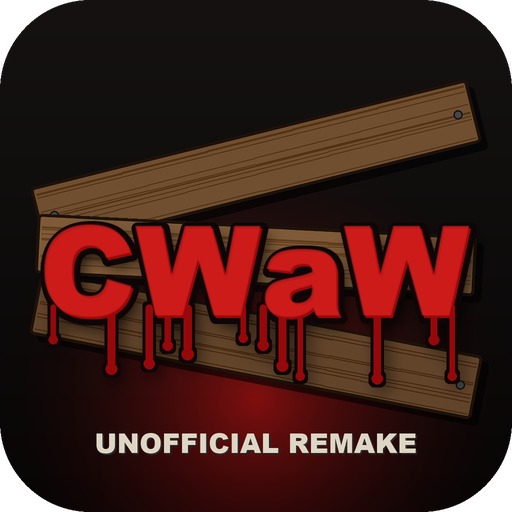

<p align="center"></p>

# CWaW – unofficial remake of Call of Duty: Zombies (iOS, 2010)

**CWaW** is a **Godot 4** reimplementation of "Call of Duty: Zombies" for iPhone (2010, Ideaworks / Activision), which
no longer runs on modern 64-bit devices. This repository contains **code only**: the game engine (GDScript scripts)
and the tools that read the original game's data. **No original game content is included** (models, textures,
sounds, music, videos, text, scripts): everyone extracts it from **their own copy** of the app, as with OpenMW and
other reimplemented engines.

> **Legal notice.** This is an unofficial fan project. It is not affiliated with, endorsed by, sponsored by or
> approved by Activision, Treyarch or Ideaworks. "Call of Duty" is a trademark of Activision Publishing, Inc.; all
> original game content belongs to its respective owners. This repository contains **no original game content**, and
> none may be added to it. Never share `original/`, `extracted/`, `game/assets/` or any build (`build/`, `.ipa`,
> `.app`): they contain the game's data. Builds are for your own devices only.

Data source: `Call_of_Duty__Zombies_1.5.0_ios_3.0.ipa` (armv6, Ideaworks **Airplay SDK 4.3** engine, logic in **Lua 5.1**).
Maps: Nacht der Untoten, Verrückt, Shi No Numa, Der Riese (single player).

## Getting your copy of the game
You need your own copy of **Call of Duty: Zombies 1.5.0 for iOS** (`.ipa`) (you can download it https://archive.org/ or 
in other sites.

## Requirements
- A Mac with:
  - **Godot 4.7**: `brew install --cask godot`
  - **Python 3**, **ffmpeg**, **Java** (for unluac) and **Lua**: `brew install python ffmpeg openjdk lua`
- Your copy of the game: a Call of Duty: Zombies 1.5.0 `.ipa` file (see above)
- For iPhone: **Xcode** (from the App Store), an Apple ID, a cable and Godot's iOS export templates

## Installation
```sh
tools/import_ipa.sh ~/Downloads/Call_of_Duty_Zombies.ipa   # -> original/kiwi.app (ignored by git)
tools/build_assets.sh                                       # -> extracted/ and game/assets/ (ignored by git)
/Applications/Godot.app/Contents/MacOS/Godot --headless --path game --import
/Applications/Godot.app/Contents/MacOS/Godot --path game    # play on the Mac
```

## Building for iPhone
1. **Godot iOS templates** (once, ~1 GB): open the project in the Godot editor (`Godot --path game -e`) →
   *Editor → Manage Export Templates → Download and Install*.
2. **Xcode**: *Settings → Accounts* → add your Apple ID (a free one is fine). Note down your *Team ID*.
3. **iPhone**: connect it with a cable, *Settings → Privacy & Security → Developer Mode* → turn it on (the phone restarts).
4. **Build** (two modes of `tools/build_ios.sh`):
   - `tools/build_ios.sh [--lang en|it]` → `build/CWaW-unsigned.ipa`, **unsigned** (plus the Xcode project in `build/ios/`):
     sign and install it yourself with the tool you prefer (Xcode, Sideloadly, AltStore...) using your own Apple ID;
   - or `tools/build_ios.sh [--lang en|it] <TEAM_ID>` → only the Xcode project `build/ios/CWaW.xcodeproj` with your team:
     open it, choose the team in *Signing & Capabilities* (and, if needed, a bundle identifier of your own), select
     the iPhone and press ▶︎.
5. On first launch: *Settings → General → VPN & Device Management* → trust the developer certificate.

`--lang` sets the app's default language: English (`en`, the default without `--lang`) or Italian (`it`); it can be
changed in the game anyway (*Options → Language*). The script sets the custom feature `lang_en`/`lang_it` of the
export preset for the build only (`game/export_presets.cfg` is always restored).

With a free Apple ID the app expires after **7 days**: it has to be signed and installed again (step 4). With the
Apple Developer Program (€99/year) it lasts a year.

## Troubleshooting
- **Java missing** (unluac fails): `brew install openjdk` and make `java` available on your `PATH` (Homebrew prints
  the command to do so after installing).
- **"iOS export template missing"**: install the templates from Godot (*Editor → Manage Export Templates*).
- **Godot import errors after rebuilding the assets**: re-run
  `/Applications/Godot.app/Contents/MacOS/Godot --headless --path game --import`.
- **The app won't open on the iPhone**: trust the developer certificate (*Settings → General → VPN & Device
  Management*) and make sure Developer Mode is enabled.
- **The app stops opening after 7 days**: the free signature has expired; re-sign and reinstall it (step 4 above).

## Structure
```
original/kiwi.app     your copy of the game (not in the repository)
extracted/            contents of the .dz archives (*.group.bin groups; not in the repository)
game/                 Godot project: scripts/ (game engine), shaders/, scenes/, tools/ (previews)
game/assets/          data converted from the original game (not in the repository): textures, sounds,
                      lua (decompiled scripts), lua_bytecode, models, characters, levels
tools/                extractors and converters (Python), build_assets.sh, build_ios.sh, run_godot.sh
analysis/             analysis notes and dumps
build/                iOS export (not in the repository)
```

## License
The code in this repository (engine, tools, tests) is released under the **MIT** license: see [LICENSE](LICENSE).
The license does **not** cover the original game or the data the tools extract from it. `tools/bin/unluac.jar` is
[unluac](https://sourceforge.net/projects/unluac/) by tehtmi, under its own license (see the project's website).

Model preview: `Godot --path game -s res://tools/preview.gd -- res://assets/models/levels/nacht/environment.glb out.png 30 -45 0.7`

## Playing (prototype, Mac)
```sh
/Applications/Godot.app/Contents/MacOS/Godot --path game            # Nacht der Untoten
/Applications/Godot.app/Contents/MacOS/Godot --path game -- nacht --autotest 120   # bot + log + screenshots in analysis/autotest
```
Without arguments the logos (Activision, Treyarch, Ideaworks) and the intro video play, skippable with a tap or a key,
then the main menu (original textures) to choose the map; with any option (tests, `--view`...) there is no intro.
Controls: WASD, mouse, left click shoots, V knife, R reload, Q switch weapon, E buy/repair, Shift sprint, Space jump, Esc pause.
On touch (iPhone): the original "Touch Screen" controls in their original layout and art: move stick bottom left, drag on the right to look (also while holding fire), fire and aim-down-sights buttons on the right, knife bar bottom centre, a hand button to buy/use that appears only when something is in reach, the special item button under the ammo (tap to throw/plant, double tap to change type), tap the ammo icon to reload and double tap it to switch weapon, pause on the score icon; remake extras: RUN toggle above the stick and JUMP under the aim button (`scripts/touch_controls.gd`). `--touch-ui` shows them on a Mac; `-- nacht --autotest 100 --touch-test --touch-ui` checks them with real touch events.
Language: Italian and English (*Options → Language* in the main menu and in the pause menu, `language` in settings.cfg, applied at once; *Default Settings* brings back the build's language: Italian when run from source on the Mac, English or Italian in an iPhone build, see `tools/build_ios.sh --lang`; `--lang en|it` overrides it for one run). All texts go through `scripts/lang.gd` (`Lang.t`, Italian text → English); in English the original game's texts are used where they exist (prompts like "Open Door [Cost: 1000]", pickups, pause and options, achievements), read at run time from `game/assets/frontend_text.json` (`loc`: every string of the original localisation, built by `tools/frontend_text.py`) and `achievements.json`, never copied into the repository. The original Italian localisation is an untranslated copy of the English one: the Italian texts of help pages, map and difficulty descriptions, game over, pickups and "No Ammo" are the remake's own (`lang.gd` `IT_TEXT`/`IT_MAPS`/`IT_HELP`); the credits stay original. Centre messages and prompts wrap within the screen (`hud.gd`). Interaction prompts follow the device: on the Mac they name the key ("Tieni premuto E per…" / "Hold E: Buy Thompson [Cost: 1200]"), with touch controls the hand button ("Tieni premuta la mano per…" / the original iPhone text "Buy Thompson [Cost: 1200]").
Settings → "Dimensione schermo" (screen size, 100% down to 80%, `screen_scale` in settings.cfg): shrinks the whole picture (3D, HUD, touch buttons, menus) around the centre with black borders, to keep it clear of the Dynamic Island/notch and rounded corners; on iOS/Android the default comes from the display safe area (side and top insets), on the Mac it is 100%; look sensitivity is compensated (`screen_frame.gd`: 2D via the root's global canvas transform, which input follows too; 3D drawn by a mirror camera in a SubViewport). Settings → "Schermo intero" (*Full screen*, `full_screen`): an explicit switch over it: on, the picture fills the whole screen whatever the slider says (the slider is greyed out); it defaults to the automatic choice (on on the Mac, off where the safe area shrinks the picture) and, once saved, the player's choice always wins after a restart; *Default Settings* brings back the automatic values. Debug: `--screen-scale 0.8`, `--auto-scale 0.86` (pretend an iPhone's automatic value); checks: `-- --frame-test menu [--auto-scale 0.86]`, `-- nacht --frame-test game` (screenshots `analysis/preview/margini_*`).
Camera smoothing: the player moves at the physics rate (60 Hz) while 120 Hz screens (ProMotion iPhones, Macs) draw twice as many frames; the camera is placed each frame between the last two physics positions (`player.gd` `_process`, at most 1/60 s behind; turning is not delayed), otherwise the stop-and-go view while strafing looked like a doubled "ghost" image. Check: `-- nacht --ghost-test right|left` (`ghost_tests.gd`: consecutive frames `analysis/preview/ghost_*.png` and the camera step per frame).
Debug: `-- nacht --look <entity,...>`, `-- nacht --shots <weapons,...>`, `-- nacht --spin` save screenshots to `analysis/preview`;
`--shots` also takes `fire=<weapon>`, `reload=<weapon>`, `drink=<perk>`, `aim=<weapon>`, `swing=<stab|slash>[/<CItemKnife model>][@side]` (frames of firing, reloading, drinking, aiming down the sights, knife stab/slash);
`--arms-donor weapon=other` tries another weapon's arms. `--debug-start` (or the DEBUG switch in the menu) starts at
round 5 with the Ray Gun and 10000 points, without achievements or statistics. Debug captures use the test achievements save.
`--column "x,z;..."` lists all solid and visible surfaces on the vertical line through a point (holes in the floor, low beams);
`--no-leftovers` shows only the main LOD variant, without the pieces taken from the other variants.
`-- nacht --bounds-test reach|escape [--bounds-from "x,y,z,yaw"] [--bounds-log]` checks the player bounds (`level.gd` `player_allowed`: the remake's jump does not carry you over railings and low walls; the player stays above the part of the original navmesh reachable on foot, windows and bars excluded; active only on the maps in `BOUNDED_MAPS`, for now Nacht): `reach` walks the whole map and reports rejected points, `escape` jumps forward for 6 s and checks it is still inside. On Nacht the upper floor has closer fog (`ZONE_FOG` in `game.gd`) that hides the unfinished back of the map seen through the openings. `--pick-px "x,y;..."` with `--view` tells which mesh is drawn under a pixel.
`-- nacht --stairs-test` opens the debris and makes the player climb to the upper floor (prints OK/FAIL);
with `--no-open` it checks that jumping does not get past the debris. `--look Entity@degrees` frames from the side:
front views hide rotation errors. `tools/run_godot.sh <seconds> -- ...` runs with a time limit.
From photo-mode shots (pause → "Modalità foto (debug)" (photo mode)): `-- verruckt --view "x,y,z,yaw,pitch;..."` recreates
the same shots (`view_<n>.png`), with `--pick` prints what a bullet fired at the center hits (mesh, texture),
with `--open Entity,... [seconds]` opens the debris first. `--walk "x,y,z;..."` makes the player walk along the points
(`--open`, `--nav` to follow the navmesh, `--buy` to buy whatever blocks it), `--box-at <entity>` fixes the box location,
`--orient-probe` measures the free space around perks and boxes, `--orig-lods` re-enables the original's per-sector
low-detail variants, `--debug-fx`/`--debug-cones` list the effect surfaces and light cones (cards with `CIwAmbientFaderSpec` fade with distance like the original: min alpha up to near, max from far, linear in the squared distance; `tools/ent_fx.py`, `IwFx.apply_fader`).

Gameplay in `game/scripts/`: `level.gd` (map, collisions, navmesh, entities), `barricade.gd`, `debris.gd`,
`player.gd`, `zombie.gd`, `game.gd` (rounds from `waves.json` extracted from the original Lua scripts), `hud.gd`, `weapons.gd`.

## Status
| Component | Status | Notes |
|---|---|---|
| `.dz` archives (DTRZ, LZMA) | ✅ | `tools/dz_extract.py` |
| `.group.bin` groups | ✅ 68/68 | `tools/group.py`; hash = lowercase djb2 (`tools/iwhash.py`) |
| Textures (PVRTC, RGB/RGBA, palette) | ✅ 384/384 | `tools/textures.py` |
| Sounds (IMA ADPCM / PCM) | ✅ 499/499 | sample rate derived from blockAlign |
| Lua scripts | ✅ 15 scripts, ~10.8k lines | unluac |
| `CIwModel` models | ✅ 1324/1324 | `tools/model.py`, glTF export `tools/export_gltf.py`; 4 complete maps |
| Materials | ✅ | base texture + lightmap (UV2, in `extras.lightmap`, not yet applied in Godot) |
| Skeletons / skins / type 3 animations | ✅ | zombies (72 anims), dogs (29), some objects; in type 3 keyframes the position belongs to the first bone of the mask (the root only if bone 0 is present); a single copy per name when several groups share the same skeleton; `tools/anim.py`, `tools/export_characters.py` |
| Type 2 animations (player/weapons, objects) | ✅ | per-bone SoA positions with bias; per-skeleton position scale |
| First-person arms + weapons | ✅ | weapon attached to bone 22 of the arms, paired animations (`tools/pair_arms.py`) |
| Main menu / front end | ✅ | pages like `frontend.group.bin` (`scripts/frontend_art.gd`: `CIwGuiResource` layout positions in 480×320 units): title `fe_title` (logo, tap → menu; only at startup, no text: "Touch screen to start" is unused), "Menu principale" (main menu: Single Player, Extras, Options), Single Player (Regular/Recruit difficulty with the original description in the bottom panel, New Game, Continue), Level Select (list on the left, panel with drips `9dede741`, white frame `ad5ebcb2` with the preview, description), Extras, Options; title bar, rows with the atlas `highlight` strip, "Indietro" (back) at the bottom left, `CGuiFrameBloodSplat` splats (c6054a8a..f, estimated positions); `loading` screen (black + `lo_spinner` f6bbb293 32×32 at (50 %, 60 %), steps of `LoadingSpinnerSpeed` 150/4096 of a turn every `LoadingScreenCallbackMs` 200 ms) until the navmesh is ready (`scripts/loading_screen.gd`); "Luminosità" (brightness; `se_brightnessslider`: `BrightnessSettingMinMax` {1,15} inverted, IwGx: above 8 black with alpha 3·(b−8), up to 8 additive grey (8−b)·8, 10 neutral = estimated default; `Settings.apply_brightness`); achievements like `fe_view_achievements` (list + panel with score/completion and "COMPLETED!" stamp `4270e3c2`, totals at the bottom right); tapping the unlock popup opens `ig_viewachievement` (game paused); original textures, map choice with the map text (`CMapInfo`); at startup the original splash (`splash.group.bin`: 3 logos, `SplashScreenMs` 3000 ms each, kiwi 0x1743a4) and then `IntroVideoPath` (`tools/intro_video.sh`: ffmpeg without Theora → PNG frames + WAV encoded to OGV by Godot's movie writer, black bars cropped), skippable; `mx_frontend` music looping (loop count 0 in the `CIwSoundSpec`) and `menu_press` on buttons (`scripts/ui_sound.gd`); "Opzioni" (options: settings + "Livello di dettaglio" (level of detail) → 3D render scale/LOD, "Pausa automatica" (auto pause), "Impostazioni predefinite" (default settings), "Lingua" (Language, `lang.gd`), reset of achievements and statistics, with confirmation), Help (Gameplay, Performance), Local Leaderboards, Credits (scroll after `CreditsScrollDelay` 2 s), About: original English texts (the Italian localization is a copy of the English one) from `tools/frontend_text.py` → `frontend_text.json`; pause like `ig_pause` ("Opzioni" → `ig_options`: "Impostazioni" (settings), Help, "Impostazioni predefinite") plus "Classifica locale" (local leaderboard) and "Ricomincia livello" (restart level; with confirmation, restarts from round 1, deletes the save); `scripts/frontend_menu.gd`, `extras_screen.gd`, `options_screen.gd`, `frontend_options.gd`, `intro.gd`, tests `--frontend-test intro|menu`, `-- <map> --frontend-test pause` |
| Character parts | 🔶 | meshes split per part; known names: body, legs, neck, leftarm, rightarm, leftelbow, rightelbow, headb, sleevel, sleever |
| Level entities | 🔶 | names, transforms, components, costs and weapons (`tools/entities.py`); component details not yet |
| Wave tables | ✅ | `tools/lua/dump_waves.lua` → `waves.json` (run from the original Lua scripts) |
| Collisions / navmesh | ✅ | generated in Godot from the geometry; on Shi No Numa the original `CIwNavMesh` (`tools/navmesh.py` → `navmesh.json`, flag 4 = stairs/ramps, 2 = under water) adds a zombie/dog-only floor where the geometry has none (plank bridges and stairs without collision, terrain beyond the jungle backdrops); the original's invisible walls and ceilings (entities with only `CIwColliderSpec` + `CFlagsSpec` 0x08000000, the flag of hittable targets: Nacht 9, Verrückt 39, Shi No Numa 9, Der Riese 54) on a separate layer that stops bullets and grenades but not the player, zombies or the navmesh (`scripts/shot_blockers.gd`); zombie shortcuts `CRouteShortcut` (`tools/route_shortcuts.py` → `shortcuts.json`, Der Riese 11, Shi No Numa 1) as zombie-only `NavigationLink3D`s: jump-downs (ASM states 46-49, `31de2d9f`…`31de2da2` by height) and climbs (state 50 `aa8af536`, 4.83 s) with the original root motion, on Shi No Numa a 1.2 s walk + fall (states 40-42 of the jap ASM); dogs don't use them (`scripts/route_shortcuts.gd`, test `-- derriese --shortcut-test`) |
| Nacht gameplay | 🔶 | rounds, spawns, windows, vaulting, chasing, attacking, wall weapons, debris, knife (original states 39 "Stabbing" arms `73ede5dc` 1 s and 40 "Slashing" `f1a640ed` 0.633 s, `CItemKnife` model in the left hand, bone 6; stab if the zombie is within 2.5 m and ~12° (kiwi 0x205e7c), otherwise slash; damage at 0.199 s (`knifeDamage`), then the weapon comes back up (switchGun → state 11); `scripts/viewmodel.gd`, `scripts/player.gd`), points, lightmaps; paid repairs (10 points) only up to the round cap `SetRepairQuota(min(round × 5, 50))` (kiwi file 0xfaf30; after that boards are repaired for free; `scripts/repair_quota.gd`, saved); heartbeat on every hit taken, 5 s from volume 1 to 0.5 (`HeartbeatDurationMS`, `scripts/heartbeat.gd`); per-state turn rate like the original (walking 1.5 = base, running/sprinting 1.0, knife/grenade/drinking 1.5, aiming 0.5; sideways 0.5/0.5/0.25, the remake's sprint); zombies that in 30 s neither cover 25 m net (`ZombieBleedOutTime`/`Distance`) nor attack are removed and replaced (not if the player can see them); ambient moans from the nearest zombie within 20 m, pause × clamp(1/living zombies, 0.1, 1) |
| Other maps | 🔶 | areas/links from the Lua scripts (`level.json`); spawns as in `AvailableSpawns` (spawn *n* → window *n*, Verrückt courtyard windows, windowless swamp zombies on Shi No Numa, local spawn near the player on Shi No Numa: area from `SelectRandomArea`, uniform start between the player's area and the open neighbouring ones, then the first one with spawns; one of the 4 kept by `PickRandomClosestSpawn`); areas opened by Lua triggers with "NA" links (Der Riese, Shi No Numa) and by the generator; entity names known only by hash recovered by `tools/resolve_names.py` → `names.json`; test `--reach-test [--from Entity] [--probe x1,z1,x2,z2]` |
| Rounds | ✅ | `waves.lua`: initial zombie *i* at *i* × `InitialSpawnSpeed`, then one every `SpawnSpeed` from (`InitialSpawns`+3) × `InitialSpawnSpeed`; at the limit of 24 alive the spawn skips a turn; `end_wave` 2 s after the last kill (0.5 s with `FastWaves`), next round 6 s later (5 s on maps with dogs); after round 40 `ZombieWaveEquationFull`; never the same spawn twice in a row (`PickRandomSpawnNumber`); Recruit/Regular difficulty (`GetDifficulty` 1/2, columns 3–5 = co-op; Recruit without achievements or statistics) in the menu and in the settings; test `--wave-test [--wave-log]` |
| Dogs (hellhounds) | ✅ | Shi No Numa and Der Riese, from `waves.lua`: dog rounds after more than 2 rounds (1 in 2: `RandomNumber(1, 3)` excludes the upper bound; always after 4), 6 dogs in the first two dog rounds and then 8 (`DogNumberCalculation` in the bytecode ignores difficulty), 300 hp × number of dog rounds, at most 2 alive, spawning in the player's area with the original lightning (`normal_dogSpawn`/`flame_dogSpawn` = spec list `6be7f502` of the effects group: 8 models, lives 1.5 s and the dog appears at its end, `CDeathActionSpawnSpec`; `scripts/dog_spawn_fx.gd`, `--dog-fx-look`), fog, Max Ammo from the last one; half are fire dogs (`flame_dogSpawn`: flames on the back, harmless fire explosion on death); `scripts/dog.gd`, tests `--dog-test`, `--dog-look [--flame]` |
| Traps | ✅ | electric (Verrückt, Der Riese, Shi No Numa huts) and flogger: active for 30 s, kill zombies/dogs (no points) and hurt the player (they turn on 2.3 s after purchase, lever animation), then 30 s cooldown (+2 s of animations, from ASM `2b8efeb7`); flogger from ASM `b373d4cb`: lever 0.875 s, start-up 5.98 s (kills from 3.3 s), motor/hiss loop (Trap_FloggerSound1/2), slow-down 7.5 s (still kills for 2 s), then 30 s, with the original sounds; power is required where there is a generator; volume from the `<trap>Effect<n>` entities, on Verrückt from the geometry; original arcs: the `<trap>Effect<n>` are instances of spec lists `e29069ed`/`c5e4a13d` (cards `c5ea57f2`/`fda76742`, texture scrolling 32 texels per tick), on Verrückt child entities of Trap1/Trap2 (`tools/ent_fx.py` → `levels/<map>/ent_fx.json`, `scripts/iw_fx.gd`), loops from the `<trap>Sound`/`Sound1`/`Sound2` emitters (traploop like the ambient emitters); test `--trap-fx-look` (`scripts/fx_tests.gd`); `scripts/trap.gd`, test `--trap-test` (`--trap-debug`) |
| Teleporters / Pack-a-Punch | ✅ | Der Riese: with power on, a pad is activated and linked to the mainframe; each link opens the mainframe door, the third opens the Pack-a-Punch (5000: magazine/reserve of the original `*_upgrade`s, damage ×1.5, WaW names); teleport 1500 with cooldown, power-up or dogs on arrival; teleporter engine like `CTeleporterPeer`/`CTeleporterMain` (kiwi va 0x16e5dc–0x1703c8): linking lasts 30 s (`TeleporterLinkingTimeMs`) with `pa_beep_link_count_start`, `countdown` line, `countdown_tick` every 250 ms, `pa_link_count_<n>` countdown (`TeleportPeerCounterTimeMS` thresholds from `console.bin`: 20, 15, 10…1 s) and HUD clock (`hud_teleporter_clock`/`hud_clock_hand`, texture 54f786f3, half a turn in 30 s); expired → `pa_beep_link_count_fail`; linked → `pa_beep_pad_active_1/2/3` and the pad fires once; after the third, 3.2 s → `pa_beep_pad_active_all` + `linked_teleporters`; teleport: fires after 1.98 s (`TeleporterStartTimeMs` from `console.bin`), arrival at point d3a8fb56 of `CTeleporterMainSpec`, 20 s cooldown, after 2.39 s (`TeleporterRematerializeTimeMs`) `teleported` + `tele_tinitus` + `pa_beep_teleport_successful`; `teleport_incoming` at the mainframe; from start to rematerialization the `CSplashEffectSpec`s of pad and mainframe (5000 damage every 100 ms to zombies and dogs in the box, `teleKill` statistic) → achievement "The Poetry of Steak"; on teleport start the original effects of `derriese.lua` Teleport: `teleporterLeave` at `TeleporterPeer<X>_fxSpawn` and, 750 ms later, `teleporterArrive` at `TeleporterMain_fxSpawn` (flames `eaf92f38` 4 s, then on the entity's death 3× rising sparks `c85423be` / 3× light beams `591931b2`; `CRenderableEffectEmitterSpec` decoded from kiwi in `scripts/effect_emitter.gd`, `scripts/tele_fx.gd`, test `--telefx-test`); linking in progress and cooldowns are saved; `scripts/teleporter.gd`, `scripts/pack_a_punch.gd`, tests `--tele-test`, `--pap-test` |
| Verrückt | ✅ | split start: random German or American half (`--start german|american`), the `StartDoorLink` door opens with power |
| Barricade/debris orientation | 🔶 | debris: transforms with an identity quaternion keep quarter turns in the "flags" byte (0x10 = −90°, 0x04 = 180° around Y, `Level.flag_transform`), also for the model's child transform; the collider is in the entity's space; test `-- <map> --debris-test [--shot Entity@degrees]`. Barricades: direction from the wall, inside/outside from the sectors (`tools/wall_yaw.py`); perk machines, switch and boxes also use the flags (`--orient-probe`: with the flags the back is always against the wall). Barricades with their own rig (Nacht `mysteryboxroomZombieWindow3` `4b84e4d2`, Verrückt `4a7f842b`/`9a6665e4`/`9a707fea`): 6 boards (states "0".."6" of ASM `4b84e4d2`), sounds `43dd4a39`/`e3f3e537`, test `--altwin-test` |
| Sectors and LOD | ✅ | `CIwSGSectorBuilder` → `sectors.json`; `CIwLODControllerCameraVolume` shows the variant of the camera's sector |
| Mystery box | ✅ | 950 points; follows ASM `350fb630` (Nacht `f3e136cb`) with animations by name: opening 1.458 s (`music_box_open`), then the weapon rises in a straight line from `MysteryStartGunOffset` to `MysteryEndGunOffset` (×4 estimated: from 0.25 to 1.25 m, 0.32 m back) in 4 s cycling through 13 weapons (`MysteryNumOtherGunsToShow`, `music_box_play`), offered for 12 s, descent 4 s (still takeable), closing 0.833 s (`music_box_close`); teddy bear: waits 1 s, rises to `MysteryEndTeddyBearOffset` in 2 s, the box flies away with the lid open (`c7403104` at 3.5×, `box_flyaway`, `teddypoof`, light beams of effect `03ca2c23`) and lands elsewhere (`c7403104` reversed at 5×, `box_fall`, `teddyland`); test `--box-anim-test [teddy]` (`scripts/box_anim_tests.gd`); starts at the level's `MysteryBoxes[1]`; teddy bear from the per-map `console.bin` variables (`MysteryUsedCountTeddy`/`MysteryResetUsedCountTeddy`/`MysteryTeddyBearPercent`: Verrückt 10/3/10 %, Shi No Numa and Der Riese 3/2/20 %); per-map contents from `MysteryWeapons<map>` (Nacht with the Betty, Shi No Numa and Der Riese with the Wunderwaffe, Der Riese without sawed-off/Springfield/Arisaka and with Monkey Bombs; everywhere .357, Kar98k, M1 Carbine and Molotov); tests `--box-test`, `--boxlists-test lists` (`scripts/box_tests.gd`); stands of empty box locations (`7e489a07`/`7cf1b0c8`: boxes with the teddy bear, hidden where the box is, `scripts/map_props.gd`, test `--stands-test`); Der Riese: the tower clock (`Link_oLC_L_Trigger1`, hand ticking every 1.79 s with `2024f29b`, test `--panel-test`) |
| Molotov | ✅ | from the box (`CItemMolotov`, `CActionBuyMolotov`: 4 = `MaxMolotovs`, no per-round refill); as in the original the "special" slot has a selected item: T (touch ⇄) switches grenades ↔ molotovs, G uses them (hold: `Lightingmolotov` 2.54 s with the lighter, release: `Throwingmolotov`, the bottle leaves at 0.299 s); when the molotovs run out it switches back to grenades; the bottle (`c3e1f4c9`) breaks on the first impact: splash `6aba17b5` 250 fire damage within 3 m (line of sight beyond 2.4 m, never the player), hit zombies catch fire (`zombieonfires`, visual only, no damage over time), flames on the ground and `molotov_explosion` sound; saved (`molotov_belt`); `scripts/molotov.gd`, `scripts/molotov_belt.gd`, test `--boxlists-test molotov` |
| Flamethrower cabinet (Nacht) | ✅ | entity `41870615` (`CCabinetSpec` + `CActionBuyWeaponSpec`), ASM `6d80abac`: closed "open the cabinet [2000]" → animated doors (`7ac8dfb3`, 0.77 s, `cabinet_open` sound) and flamethrower; once open it stays open and sells ammo for 380 (or the weapon for 2000 if you no longer have it); state saved; `scripts/flame_cabinet.gd`, test `--boxlists-test cabinet` |
| Perk-a-Cola | ✅ | Juggernog (250 hp), Speed Cola (reload ×0.5), Double Tap (fire rate ×0.75), Quick Revive (solo: revives once, loses perks); power from the `GeneratorSwitch` on Der Riese/Verrückt (`--power` turns it on immediately), Shi No Numa a random perk per location; original icons in the HUD; `scripts/perk_machine.gd`, `scripts/perks.gd`, test `--perk-test` |
| In-game sounds | ✅ | perk hum from the original `SoundPerkHum*` emitters (perkhumloop `d998719b`, entity position and radius, `perk_machine.gd`); `tools/sound_index.py`: reconstructed names, original reload sequences, firing from `CItemGun`, ambient channels, `CIwSoundSpec` parameters (`specs`: volume, pitch, min/max distance, "next" spec); `scripts/sfx.gd`. Ambient emitters (`CSoundEmitterSpec` on from the start, `tools/entities.py` "sound_emitters"): wind/sparks on Nacht, Verrückt, 41 on Shi No Numa, Der Riese; looping, volume = max vol. × distance (linear min→max of the spec) × height (fades out within the emitter's vertical "range"), like `CSoundEmitter` (kiwi 0x148c74), `scripts/ambient_emitters.gd`. Character lines from the code (Shi No Numa, Der Riese): ammo_low/ammo_out (total ≤ 35 % of the magazine), been_hit, close_kill (knife or ≤ 1 m, 30 %), teddy, weapon_bad/weapon_good (bytes 0x141/0x140 of `CItemGun`), packapunch, `scripts/vox_lines.gd`. Debris: each one's ASM sound (c82c1277, a66ed71a, dooropen, 8737cbb6; none for the Der Riese doors that don't have one); flamethrower ignition (ae363ff4); fly trap loop ("next" 3a700d20); test `--sound-test` (`scripts/sound_tests.gd`) |
| Der Riese: bridge and fly trap | ✅ | drawbridge that lowers with power (steam with the original CIwGFXEmitterSpec values, `scripts/iw_emitter.gd` also used for the Nacht barrel explosion, sounds, collision `col_Link_pC_pC`), `scripts/bridge.gd`, test `--bridge-test`; fly trap to be shot with a Pack-a-Punch weapon: ring of sparks, voices, then 3 objects to find and shoot, `scripts/flytrap.gd`, test `--flytrap-test` |
| Shi No Numa | ✅ | wadeable swamp: the water (texture `72339cb6`) is visible but not solid, you walk on the bottom of the original navmesh (0.3–1 m below the surface; player, zombies, dogs, grenades, bullets; fallback bottom at −1.25 m where the navmesh doesn't reach), the player moves at half speed in the water (`WaterMoveSpeedModifier` 2048/4096 in `console.bin`); swamp zombies (`<Area>ZombieSwampSpawn<n>`, `_water` template: they rise out of the water with splashes and sound `9c17d777`); spawns behind the jungle backdrops: the zombie walks in until it reaches the navmesh; the swamp's 16 board-less "windows" (`fishingSwamp`/`storageSwamp`/`commRoomSwamp` `ZombieWindow<n>`, `AvailableWindows`) are arrival points: the zombie goes there and then chases; the first doors (`Link_StRm_SwRm_no1/no2`) don't open the `ledge`; `killstreak1..3` lines at 3/5/7 consecutive headshots (Der Riese too); zipline (`ZipLine`, `CZiplineSpec`): `ZiplineDoctorSwitch` lever near the doctor's hut (activates for free, opens the `ZipLineDoorLink` gate and the `ledge` area, then "calls" it for 1500), 6 s ride (`ZiplineMovementTime`) for 1500 in both directions, 30 s wait on arrival, kills zombies on its path; `scripts/zipline.gd`, test `--swamp-test map|rise|spawns|walk|wade|zipline` (`scripts/swamp_tests.gd`) |
| Weapons (original values) | ✅ | `tools/weapon_stats.py` → `analysis/weapon_stats.json`: `CItemGun` layout from `CItemGun::Serialise` (ARM, va 0x2132c0), damage from `CItemGun::GetDamage` (va 0x238a40: penetration, per-hit-zone multipliers, damage falloff with distance, shotgun cone, minimum damage), fire rate/reload from `CIsAnimStateMachine` states, Ray Gun/grenade splash from `CSplashEffectSpec`; used in `scripts/weapons.gd` |
| Weapons: first-person states and sounds | ✅ | `tools/weapon_states.py` → `weapon_states.json` (`CIsAnimStateMachine` state format documented in the tool; `scripts/gun_states.gd`, `scripts/viewmodel.gd`): reloads with each weapon's ASM sequence (M1911 `colt_reload` 13565bed, Garand 51e1a653, double-barrel/sawed-off partial f58d101a and empty `shotgun_reload` 93f646a3), empty-magazine (23-25) and Speed Cola (26-31) variants with their durations, animations at the state's speed; Trench Gun shell by shell (start 0.98 s + 0.444 s per shell, 2 with Pack-a-Punch, end 1.17 s with the pump; shells go in one per cycle at 410 ms and, with at least one round loaded, firing during the cycle interrupts the reload); after every shot bolt/pump (states 53/54: Kar98k, Springfield, Arisaka, Trench Gun) with sound, and aiming waits for state 53 to end (no toggleAim transition); volumes: the `CIwSoundSpec`s of all these sounds have volume 4096 (1.0) like the gunshots, so they stay at -4 dB like `weapon_fire`; last shot (state 17: Garand 09664794 with the "ping", Garand and Browning have their own animations) and automatic reload at the end of the firing state; `playSoundUpgrade` 19571fe7 layer on every shot of Pack-a-Punch weapons (kiwi va 0x2070d8); running arms while sprinting (states 13-15); Monkey Bomb: throw (state 46: sequence ee068614 + `playSound3` 845a34b8..ba), on the ground ASM `93125439` (animation at 2×, c1629296 on landing, cymbals 9104e68f at 349/649 ms every cycle); test `--gun-state-test` (`scripts/gun_state_tests.gd`) |
| Wunderwaffe DG-2 | ✅ | in the box on Shi No Numa and Der Riese (`MysteryWeaponsShinonuma`/`MysteryWeaponsDerriese` in `console.bin`; `MysteryUniqueWeaponsDerRiese` = flamethrower and Wunderwaffe); 3 + 24 rounds, 0.6 s, reload 5.5 s (DG-3 JZ with Pack-a-Punch: 6 + 30, 4.7 s); Ray Gun projectile that on impact creates a `CRadialEffectWunderwaffe` (spec in `player.group.bin`, kiwi serializer va 0x1ed698): sphere growing at 4 m/s for 1 s (DG-3: 5 m/s for 1.5 s) that kills every zombie/dog in sight (damage = full health, type 6 electric), at most 10; if nothing dies within 1.5 m (DG-3: 5 m) it fizzles out; original effects: projectile trail (6 segments of 2 m, texture `371a697e`, pink DG-3 `a944f9de`), disc `89566990` and sparks, 4×2 sparks around the center; on every victim the "wunderwaffe" `CAttachEffect`: `CRenderableEffectRadialArc` arc from the Spine to the nearest zombie/dog (25 m, 0.4 s), halos `3b7a79a3`/`8417c9c1` on Spine2/neck, sheet `a8a9f968` (1 s) and lightning streaks on the ground `30e29332` (3 s); "lightning" death `407213ce`/`407213cf` (states 34/35 of ASM `f402afc2`); no light or impact sound (like the original); first-person bulb: material `e3bb8b55` (texture `2bcadef2`, additive, 8 cels 4×2 at 15 fps; `scripts/weapon_materials.gd`, same on the DG-3); Shi No Numa: all areas opened except `ledge`, after 2 s a random grave out of 9 (`WunderwaffeStart`, message `LS_WUNDERWAFFE_GAME_FIND`), E to dig: open grave and Wunderwaffe (`AddPlayerWeapon`); `SetUsingShovel(true)`: the knife becomes the shovel (`CItemKnife` "shovel", 400 damage, model `423ce590` in the original knife animations, saved); achievements "Face Melter", "Acquire Waffle Weapons" and "Wunderkind"; `scripts/wunderwaffe.gd`, `scripts/wunder_grave.gd`, test `--autotest 100 --wunder-test shot|grave` (`scripts/wunder_tests.gd`) |
| Hit effects | ✅ | `tools/hit_fx.py` → `assets/effects/hit_fx.json` (`CRenderableEffectEmitterSpec`/`CRenderableEffectSplatSpec` format documented in the tool), `scripts/hit_fx.gd`: blood on zombies and dogs from the `CHitTemplate` (effect based on the hit's damage: <40 `a8e710ae`, <150 `b73b0896`, <250 `a8621840`, above `a03f2a9e`; explosive damage → `ef263f8b` at the origin), mist facing the shooter, diamond-shaped drops that stretch and fall; stumps (model `a03e9fcc` on the bone for 1.5/2.5 s, `CDismembermentSpec` entities); bullet impacts (Shi No Numa and Der Riese only, like `SetUsingImpactEffects`): effect 0xe8 of the `CItemGun` (ring `c8e5bf94` + 3 dust/spark plumes for pistols/SMGs, shotguns/machine guns, rifles); per-weapon muzzle flashes (`CItemGun` byte 131: `943ed6eb..f1`, pink/purple for the `*_upgrade`s); Mustang & Sally: projectile `ede95410` (model `7d6f6707`, Ray Gun speed, 6 s) that explodes with splash `ab7c47a0` (1000, type 2, 4.25 m, visual `ee72b935`, sound `8e5dac4d`), `scripts/mustang_bolt.gd`; the Betty also uses the original `ee72b935` explosion; `CHitTemplate` hit sounds (`f889c48a` bullets and knife, `f889c48b` splash, none for fire); latched dogs (template `1d1ca339`); impacts excluded on Nacht/Verrückt like the original (Lua `SetUsingImpactEffects(false)`); test `--hitfx-test` (`--hitfx-look`), `scripts/hit_fx_tests.gd` |
| Player footsteps | ✅ | as in the original code (player update, kiwi `0x1a1f88`): a step when the timer expires and you are moving, the `WalkingFootstepSounds` (`player_footstep_walk3/4`) sounds or, on water, `WalkingFootstepWaterSounds` (`water_walk1/2`) in turn; interval = `FootstepSpeedMultiplier` / (\|vx\|+\|vz\|) in the player's frame (in water, at half speed, twice as long); volume/pitch from the `CIwSoundSpec`s (0x599, 0x0c00); no zombie footsteps (the original has none); test `--footstep-test` (nacht, shinonuma) |
| Achievements | ✅ | the 106 `CAchievementResource`s of `fixed/achievements/*.group.bin` (`tools/achievements.py` → `assets/achievements.json`: id, points, names/descriptions from the localization, condition class and original statistics); unlocked as in the scripts (Lua `Game.SetAchievement`: radio, dentist's chair, generator, fly trap; telephone) and from the statistics (kills, dismemberments, rounds, perks, Pack-a-Punch, teleports, traps, grenades...); 5 s popup (`AchievementMsgTimeMS`) with the `achievement` sound, saved in `user://achievements.cfg` (tests use `achievements_test.cfg`), list from the main menu and the pause menu with names/descriptions in Italian; some not obtainable here (co-op, tutorial...: `Achievements.UNAVAILABLE`); Wunderkind (108, `CAchievementWunder`): global `raygun`/`wunderwaffe`/`monkeybomb.purchased` + achievements 89, 48, 69, 1; `scripts/achievements.gd`, test `--achievement-test` |
| Power-ups, HUD, game over, saves | ✅ | drops like `CPickupManager` (kiwi 0xf36b8): 1.9 % per kill (`PickupDropOnDeathProbability`), max 4 per round, forced drop beyond 3000 points since the last one (`PickupPointsThreshold`), on Der Riese also more than 10 kills between two drops (`PickupKillThreshold` with `SetUsingDifficultyTweaks`), no drop within 1 m of another (`PickupNoSpawnCheckRadius` 400), no Double Points/Insta-Kill if already active (the Carpenter stays on all maps); `CGuiFramePowerup` icons from the HUD atlas with seconds left, blinking in the last 5 s (`PowerupGlowDurationMs`/`PeriodMs` 750), 4 s message (`PickupMessageTimeMs`); headshot streak icon "xN" (`headShot`) and `repair` icon while repairing a barricade; top right, like `hud_guns`/`ammos_container`, the icon of the weapon in hand (HUD atlas; tapping/clicking it switches weapon), the magazine drawn as in the original (`ClipVertBar` bars up to 20 rounds, `ClipHoriBar` rows beyond that, bitmap shells/bullets for shotguns and bolt-action rifles), the reserve as a number, "No Ammo", the flamethrower tank; original frame layout (points with the red splat, stacked perks and round tallies at the top left, power-ups at the top, prompts at the top center, message at 42 % of the height, scale 2); `CGuiFrameAimingReticle` crosshair as large as the current spread, red when the aim ray hits a zombie (flag +0x21 of the aiming component) (`scripts/weapon_hud.gd`, `aiming_reticle.gd`, test `--hud-weapon-test`); texts "Trade Weapons" at the box, "Open Door"/"Clear Debris" per ASM, "The door must be opened first" at the flogger; damage streaks `DamageBitmapTop/Bottom`, proximity arrows (`CGuiFrameProximityIndicator`), blinking ammo (`LowClipPercentage` 35, `LowAmmoPercentage` 20, `AmmoBlinkTime` 500), "Round 1" at the start (`ShowStartGameMessage(4000)`), with the 1 s fade from black of the `CGuiFrameGameFader` "fader" (`scripts/game_fader.gd`); Nuke and Carpenter as `CRadialEffectNuke`/`CRadialEffectCarpenter` waves (kiwi 0x18f0d8/0x1cd72c, `scripts/radial_effect.gd`): sphere growing at 15 m/s from the power-up's position for 5 s, killing (no per-kill points, with "flamethrower" flames on the body) or repairing every target it reaches and everything else at the end; 400 points only with more than 4 kills, 200 if it repaired something; fireball from emitter `c11b0e78`; every window reached runs Der Riese's `repairAll` state (clip 68af85c2 at speed 0.6 = 2.9 s, sound 27be06a0, `barricade.gd` `carpenter_repair`); game over like the original (kiwi 0x1b2f04/0x1b318c): immediately "Game Over" + "You Have Survived N Rounds" (`ig_gameover_dead`) and the `nuke_gameover` wave from the player (5 m/s for 8 s), after 3 s a camera fly-through along the map's `CCameraPath` EndCamera1..5 (`cam_flythrough`, `tools/camera_paths.py` → `camera_paths.json`, `scripts/end_camera.gd`), `gameover_intro` music and `ig_gameover` with statistics + per-map local leaderboard (`user://leaderboard.cfg`); test `--autotest 100 --endgame-test nuke|carpenter`; game saved in `user://savegame.json` (round, points, weapons, perks, areas/debris, power, box with teddy bear counters, teleporters, zipline, window boards, active and dropped power-ups, traps, easter eggs, fly trap, per-game achievement statistics; new systems: nodes in the "savable" group with `save_state()`/`load_state()`, see `save_game.gd`) when quitting to the menu, going to the background, losing focus (auto pause) and every round, "Riprendi la carneficina" (resume the carnage) in the menu; tests `--save-test write|check --resume`, `--hud-test`, `--gameover-test` (`scripts/save_tests.gd`) |
| Missing | ⏳ | iOS build |

## Formats – notes
- Resource in a group: `u32 size, u32 nameHash, body`. Polymorphic classes (e.g. `CIwSoundData`) instead have `u32 subclassHash` in place of the name, and the name is the first u32 of the body.
- Detailed formats in the docstrings of `tools/model.py`, `tools/anim.py`, `tools/textures.py`, `tools/sounds.py`.
- `CItemGun` (player group, `<weapon>` and `<weapon>_upgrade`): fields in serialization order documented in `tools/weapon_stats.py` (e.g. 0x7c magazine, 0x80 reserve, 0x84 damage, 0x78 minimum damage, 0x68/0x6c start/per-unit falloff of the damage drop-off, 0x54 targets penetrated, 0x64 loss per penetrated target, 0x60 shotgun cone, zone→multiplier table at the end, then the name). Distances in world units (designer distances are WaW inches ×10.16).
- Scale: 400 units = 1 m; s16 UVs with 4096 = 1.0; animation times in 1/4096 s; "smallest three" quaternions 3×10 bits.
